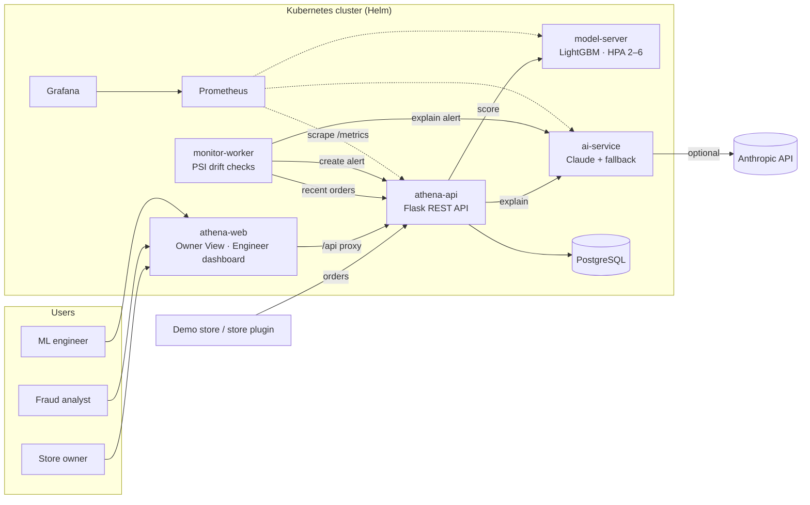
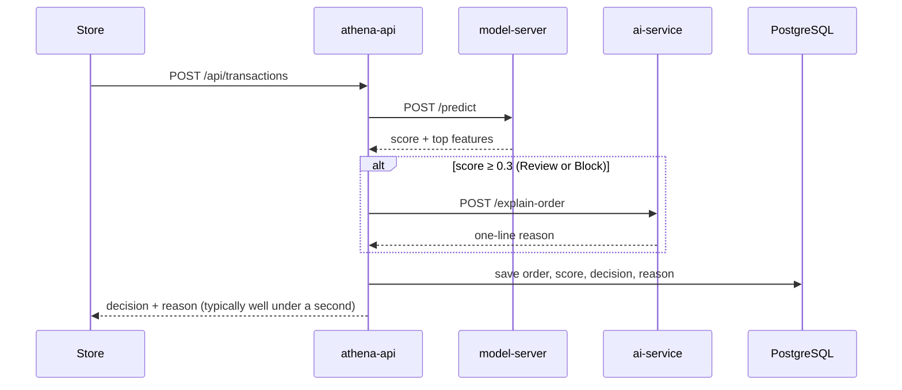

# Project Athena

[](https://github.com/sande231/Project-Athena/actions/workflows/ci.yml)


**Athena keeps fraud-detection models accurate, healthy and explainable after they go live.**

Online stores lose billions to payment fraud every year, and the models that fight it quietly get worse as fraudsters change tactics. Athena scores every order, watches for those changes (data drift), and uses Claude (Anthropic API) to explain decisions and alerts in plain English, so a store owner without an ML team can still trust and act on the results.

Fall 2026 final project, Morgan State University. Full design document: [`docs/Project_Athena_Documentation.pdf`](docs/Project_Athena_Documentation.pdf).

---

## Contents

- [Features](#features)
- [Architecture](#architecture)
- [Tech stack](#tech-stack)
- [Repository layout](#repository-layout)
- [Getting started](#getting-started)
- [Kubernetes deployment](#kubernetes-deployment)
- [Observability and resilience](#observability-and-resilience)
- [API reference](#api-reference)
- [Configuration](#configuration)
- [CI/CD](#cicd)
- [Testing](#testing)
- [Team](#team)
- [Project status](#project-status)
- [Dataset](#dataset)

---

## Features

| Feature | What it does |
| --- | --- |
| **Real-time fraud scoring** | Every order gets a fraud score from 0 to 1 and a decision: **Approve** (< 0.3), **Review** (0.3–0.7) or **Block** (> 0.7). |
| **Plain-English reasons** | Flagged orders get a one-sentence explanation written by Claude from the model's top contributing features. |
| **Drift detection** | A monitor compares live orders with the training data (Population Stability Index) and raises an alert when patterns shift. |
| **AI alert explanations** | Each alert includes a summary, likely cause and suggested action. |
| **Works without AI** | With no API key, Athena falls back to rule-based explanations. Fraud decisions never depend on Claude. |
| **Two dashboards** | An Owner View for non-technical store owners and an Engineer dashboard for model health. |
| **Analyst feedback** | Reviewers mark flagged orders as fraud or legit, giving labeled data for precision, recall and retraining. |
| **Autoscaling and self-healing** | The model server scales from 2 to 6 pods under load, and a failed pod is replaced without losing orders. |

---

## Architecture



### Life of one order



### In the background

- **monitor-worker** checks the latest orders every 30–60 seconds. If a key feature drifts (PSI > 0.2), it asks ai-service to explain the change and posts an alert.
- **Prometheus** scrapes `/metrics` from api, model-server and ai-service; **Grafana** visualizes them.
- **GitHub Actions** tests every pull request and publishes images to GitHub Container Registry on merge.

---

## Tech stack

| Layer | Technologies |
| --- | --- |
| Machine learning | pandas, NumPy, scikit-learn, LightGBM, Optuna, joblib |
| Backend | Python 3.11, Flask, Gunicorn, SQLAlchemy, PostgreSQL |
| AI | Anthropic API (Claude), official Python SDK |
| Frontend | HTML, CSS, JavaScript, Plotly.js |
| Containers | Docker, Docker Compose |
| Orchestration | Kubernetes (kind), Helm, Horizontal Pod Autoscaler, metrics-server |
| Observability | Prometheus, Grafana (kube-prometheus-stack), prometheus_client |
| CI/CD | GitHub Actions, GitHub Container Registry |
| Testing | pytest, custom load tester |

---

## Repository layout

```text
Project-Athena/
├── ml/                     # Training pipeline
│   ├── train.py            # LightGBM + logistic baseline, optional Optuna tuning
│   ├── features.py         # Feature engineering shared by training and serving
│   ├── drift.py            # Population Stability Index (PSI)
│   └── data/               # Dataset goes here (not committed)
├── services/
│   ├── api/                # REST API + database models
│   ├── model_server/       # Loads the model, returns scores + top features
│   ├── ai_service/         # All Claude calls, with rule-based fallback
│   ├── monitor/            # Drift and flag-rate checks, creates alerts
│   └── web/                # Owner View, Engineer dashboard, demo store
├── helm/athena/            # Helm chart (deployments, HPA, Postgres, ServiceMonitor)
├── k8s/                    # kind cluster config template
├── scripts/
│   ├── k8s-up.sh           # One-command cluster setup
│   ├── load_test.py        # Autoscaling and pod-kill load tests
│   └── stream_transactions.py  # Replay orders / simulate a fraud attack
├── tests/                  # pytest suite (runs in CI)
├── docs/                   # Design document and demo runbook
├── docker-compose.yml      # Full local stack
└── .github/workflows/      # CI pipeline
```

---

## Getting started

### Prerequisites

- Python 3.11
- Docker Desktop
- A Kaggle account (for the dataset)
- Optional: an Anthropic API key

### 1. Clone and set up Python

```bash
git clone https://github.com/sande231/Project-Athena.git
cd Project-Athena
python3.11 -m venv .venv && source .venv/bin/activate
pip install -r ml/requirements.txt
```

### 2. Get the data and train the model

Download the dataset into `ml/data/` (instructions in [`ml/data/README.md`](ml/data/README.md)), then:

```bash
python ml/train.py --data ml/data --sample 100000
# Optional hyperparameter tuning:
python ml/train.py --data ml/data --sample 100000 --tune --trials 20
```

This writes `ml/artifacts/` (model, drift reference statistics, validation metrics and a held-out "live" stream for demos). Until a model is trained, model-server runs a simple placeholder heuristic so the rest of the system still works.

### 3. (Optional) Add your Claude key

```bash
cp .env.example .env    # then set ANTHROPIC_API_KEY
```

Without a key, explanations use rule-based text.

### 4. Run the full stack

```bash
docker compose up --build
```

Open **http://localhost:8080**.

> **Port 8080 already in use?** Run `WEB_PORT=8081 docker compose up --build` (or add `WEB_PORT=8081` to `.env`) and open **http://localhost:8081** instead.

```bash
docker compose ps    # every service except monitor should show (healthy)
```

### 5. Send traffic and simulate an attack

```bash
pip install pandas requests
python scripts/stream_transactions.py --rate 5 --limit 500            # normal orders
python scripts/stream_transactions.py --rate 5 --limit 300 --attack   # new fraud pattern
```

Within a few minutes the monitor detects the drift and an explained alert appears on the Engineer dashboard.

---

## Kubernetes deployment

Requirements: Docker Desktop (8 GB+ memory), [kind](https://kind.sigs.k8s.io/), kubectl and **Helm 4** (the team standard; CI lints with Helm 3.16.4 as well).

```bash
# 1. Point the cluster at your local model files (this copy is gitignored)
cp k8s/kind-config.yaml k8s/kind-config.local.yaml
#    edit hostPath in kind-config.local.yaml to the absolute path of ml/artifacts (quote it if it has spaces)

# 2. Create the cluster and install everything
kind create cluster --name athena --config k8s/kind-config.local.yaml
export ANTHROPIC_API_KEY=sk-ant-...    # optional
./scripts/k8s-up.sh

# 3. Open the app (keep this terminal running)
kubectl port-forward svc/web 8081:8080
```

Then open **http://localhost:8081**. The Kubernetes demo uses local port 8081 so it never clashes with Docker Compose or anything else already on 8080.

`k8s-up.sh` builds and loads all images, installs kube-prometheus-stack **93.4.1** and metrics-server **v0.9.1** (pinned), creates the `athena-secrets` Secret, and installs the Athena chart.

**Chart highlights**

- api waits for PostgreSQL (`pg_isready` init container), so it starts with 0 restarts.
- model-server: HPA from 2 to 6 replicas at 70% CPU, 60-second scale-down window for demos, and a 5-second `preStop` delay for graceful shutdown.
- Liveness and readiness probes on every HTTP service (`/healthz`).
- A least-privilege ServiceAccount, and a ServiceMonitor so Prometheus scrapes Athena automatically.

To remove the cluster: `kind delete cluster --name athena`.

---

## Observability and resilience

Measured on the local kind cluster on 2026-11-19 (10-CPU Mac, about 9.7 GB for Docker):

| Test | Result |
| --- | --- |
| **Autoscaling** (32 concurrent requests, 180 s) | 2 → 6 model-server pods in about 60 s; back to 2 about 100 s after load stopped |
| **Throughput** | 692,870 requests, **0 failed**; p95 latency fell from ~35 ms (2 pods) to ~14 ms (6 pods) |
| **Pod kill, before graceful shutdown** | 3 pod deletions: 799 orders ok, 1 failed |
| **Pod kill, after graceful shutdown** | 5 pod deletions: 1,300 orders ok, **0 failed** |
| **Startup** | api restarts reduced from 3 to 0 by waiting for PostgreSQL |

Reproduce these with [`scripts/load_test.py`](scripts/load_test.py); the full presentation sequence is in [`docs/demo-runbook.md`](docs/demo-runbook.md).

---

## API reference

All endpoints are served by `athena-api` (port 8000) and proxied by `athena-web` under `/api`.

| Method | Endpoint | Description |
| --- | --- | --- |
| `POST` | `/api/transactions` | Score one order; returns score, decision, reason and latency |
| `GET` | `/api/transactions?decision=review&limit=50` | List recent orders, optionally by decision |
| `PATCH` | `/api/transactions/{id}/label` | Mark an order as fraud or legit (`{"is_fraud": true}`) |
| `GET` | `/api/metrics/summary` | Order counts, flag rate, average latency, precision and recall |
| `GET` | `/api/alerts` | Recent alerts with Claude explanations |
| `POST` | `/api/alerts` | Create an alert (used by monitor-worker) |
| `POST` | `/api/retrain` | Request retraining (placeholder; returns 202) |
| `GET` | `/healthz` | Health check |
| `GET` | `/metrics` | Prometheus metrics |

**Example**

```bash
curl -X POST http://localhost:8000/api/transactions \
  -H "Content-Type: application/json" \
  -d '{"order_id": "A-1042", "transaction": {"TransactionAmt": 849.99, "P_emaildomain": "gmail.com", "DeviceType": "mobile"}}'
```

```json
{"id": 1, "score": 0.86, "decision": "block", "reason": "Unusually large amount for this card and a new device.", "latency_ms": 42.1}
```

*(Example output; actual values depend on the trained model.)*

---

## Configuration

| Variable | Service | Default | Purpose |
| --- | --- | --- | --- |
| `ANTHROPIC_API_KEY` | ai-service | *(empty)* | Enables Claude; empty means rule-based fallback |
| `CLAUDE_FAST_MODEL` / `CLAUDE_SMART_MODEL` | ai-service | `claude-haiku-5-5` / `claude-sonnet-5-5` | Models for order reasons / alert explanations |
| `DATABASE_URL` | api | `sqlite:///athena-dev.db` | Database connection |
| `MODEL_URL`, `AI_URL` | api, monitor | `http://localhost:8001`, `:8002` | Service addresses |
| `THRESHOLD_REVIEW`, `THRESHOLD_BLOCK` | api | `0.3`, `0.7` | Decision thresholds |
| `MODEL_PATH` | model-server | `ml/artifacts/model.joblib` | Trained model file |
| `REFERENCE_PATH` | monitor | `ml/artifacts/reference_stats.json` | Training distributions for drift checks |
| `CHECK_INTERVAL`, `WINDOW`, `PSI_ALERT` | monitor | `60`, `300`, `0.2` | Check frequency, orders per check, drift threshold |
| `WEB_PORT` | docker compose | `8080` | Host port for the web app |

---

## CI/CD

Every pull request and every push to `main` runs [`.github/workflows/ci.yml`](.github/workflows/ci.yml):

1. **Test:** install dependencies (with pip caching), run `pytest`, and `helm lint` the chart with Helm 3.16.4.
2. **Images:** build all five service images in parallel.
3. **Publish:** on `main`, push images to `ghcr.io/sande231/athena-<service>`.

---

## Testing

```bash
source .venv/bin/activate
pip install -r services/api/requirements.txt -r ml/requirements.txt pytest
pytest -q
```

The suite covers health checks, approve/block decisions, analyst labels and metrics, alert storage, and PSI drift detection. External services are faked, so tests run without Docker or an API key.

---

## Team

| Name | Role | Area |
| --- | --- | --- |
| Isaac Rankin | ML engineer | `ml/` |
| Eian Capers | Backend developer | `services/api/` |
| Michael Orishagbemi | Frontend developer | `services/web/` |
| Sandeep Shah | DevOps engineer | Docker, Kubernetes, Helm, CI/CD |
| Aubrenesia Tomlinson | AI + monitoring engineer | `services/ai_service/`, `services/monitor/` |

Branch and pull request workflow: [CONTRIBUTING.md](CONTRIBUTING.md).

---

## Project status

- [x] All services, Docker Compose stack and Helm chart
- [x] CI: tests, Helm lint, image builds and publishing
- [x] Kubernetes demo with autoscaling, self-healing and pinned monitoring stack
- [x] Load testing and demo runbook
- [ ] Train on the full dataset and publish validation metrics
- [ ] Grafana dashboard for Athena metrics
- [ ] Retrain button launches a real training job
- [ ] Final demo rehearsal and backup recording

---

## Dataset

[IEEE-CIS Fraud Detection](https://www.kaggle.com/competitions/ieee-fraud-detection) (Vesta Corporation, via Kaggle): about 590,000 labeled e-commerce transactions, roughly 3.5% fraud. Used for coursework under the competition rules and not redistributed in this repository.
